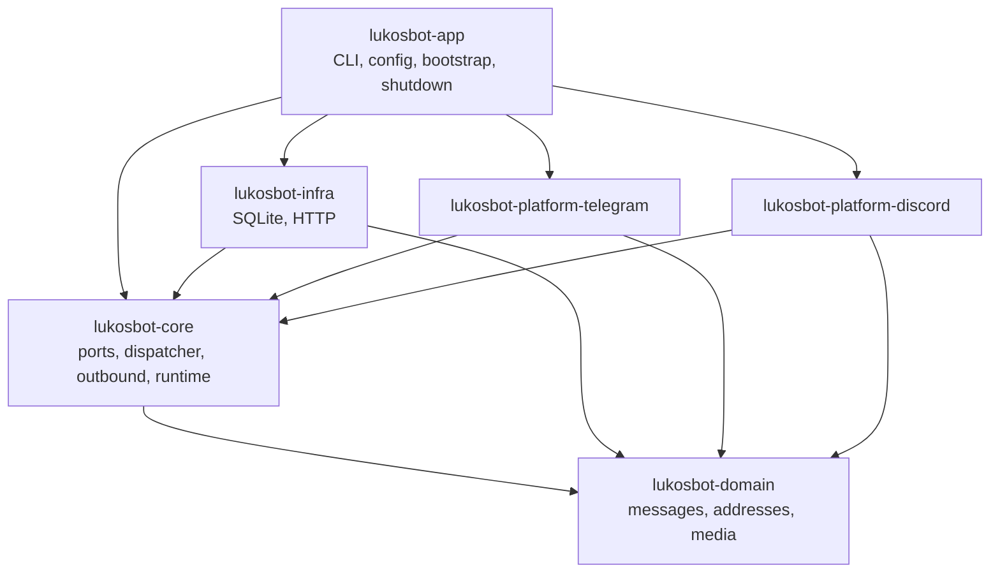
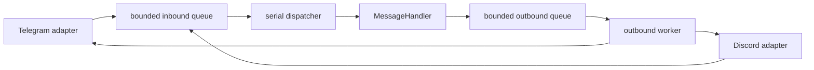

# Architecture

## Goals

The foundation separates platform SDKs, infrastructure, application logic, and process assembly so
that each can be tested without the others. It deliberately does **not** implement a command engine
or business features yet.

## Crates and dependency direction

Rules:

- `lukosbot-domain` depends on no other project crate and on no platform SDK.
- `lukosbot-core` defines ports and never imports a database driver, HTTP client, or SDK.
- `lukosbot-infra` and the platform crates implement core ports.
- `lukosbot-app` is the only composition root. It maps typed configuration onto infrastructure and
  runtime settings.

## Message flow

- Adapters normalise platform objects into `InboundMessage` before touching the queue.
- Handlers receive a `HandlerContext` with an outbound handle, the `StateStore` port, and the
  cancellation token. They never receive SDK clients or the full configuration.
- Outbound messages are routed by `PlatformKind` through one worker. Callers wait for a typed result
  (`SentMessage` / `SendError`), which applies backpressure instead of growing memory.
- The base runtime uses one dispatcher to establish per-chat ordering. Cross-chat concurrency is a
  separate design decision, not an accidental `tokio::spawn`.

## Runtime and shutdown

`AppRuntime` owns a `CancellationToken` and a `JoinSet` containing the dispatcher, the outbound
worker, and every adapter task. No long-running task is detached.

Shutdown is triggered by a signal or by a supervised task exiting unexpectedly. It then:

1. broadcasts cancellation, stopping adapters from accepting new events;
2. lets the dispatcher finish the message it is already handling;
3. rejects new outbound sends and drains the outbound queue;
4. calls `shutdown()` on every adapter concurrently;
5. closes the state store;
6. aborts anything still running when the shared deadline expires and reports it.

Every step shares one deadline derived from `app.shutdown_timeout_secs`. Failures and abandoned
tasks are reported in `ShutdownReport` and logged; nothing waits indefinitely.

## State storage

`StateStore` stores opaque JSON values under a scoped, namespaced key. The SQLite implementation:

- uses `STRICT` tables and a composite primary key covering `scope_type`, `scope_platform`,
  `scope_id`, `namespace`, and `key`;
- stores timestamps as Unix milliseconds in UTC;
- filters expired rows on read and removes them with `delete_expired`;
- embeds migrations at compile time (`sqlx::migrate!`), so startup and CI do not need a database
  URL;
- keeps domain-specific state semantics out of the foundation.

A chat's `ChatKind` is metadata and not part of the scope key, so reclassifying a chat does not
orphan state.

## Configuration and secrets

- TOML is the primary format; values are deserialized into typed structs with
  `deny_unknown_fields`, so typos fail at startup.
- Environment overrides are injected as a map, which keeps tests independent of process globals.
- Tokens use `secrecy::SecretString`: it supports `Deserialize` but not `Serialize`, and its
  `Debug` output is redacted. `ConfigSummary` is the only configuration object written on purpose.
- Logging filters follow `CLI > RUST_LOG > configuration file`.

## HTTP and SSRF

`lukosbot_infra::http::HttpClient` centralises timeouts, proxy configuration, the user agent, and
streamed response size limits. Platform SDKs own their transport: the Discord gateway uses
serenity's native-TLS backend so the process does not link a second, EOL Rustls major version.
Retries are opt-in via `RetryPolicy` and only apply to errors the caller marks as retryable.

This is **not** a user-facing URL fetcher. Any feature that downloads user-supplied URLs must add
scheme validation, private/link-local/metadata address rejection, redirect limits, and DNS rebinding
protections in its own design.

## Extension points

- `MessageHandler` is the boundary for the future command engine.
- `PlatformAdapter` is the boundary for richer platform behaviour (media upload, interactions, slash
  commands).
- `StateStore` is the boundary for preferences, admin state, and service state.
- `HttpClient` is the shared client for third-party API commands.

New crates require a concrete boundary benefit; the six crates above are intentionally the whole
workspace for now.
