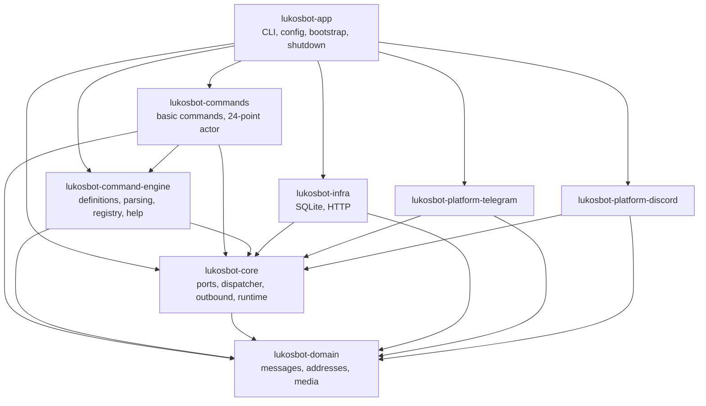
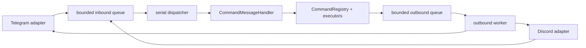

# Architecture

## Goals

The codebase separates platform SDKs, infrastructure, command parsing, concrete commands, and
process assembly so that each can be tested without the others. The current command engine covers
text commands, policy enforcement, persisted state, and core administration; media, service
scheduling, and third-party integrations remain follow-up work.

## Crates and dependency direction

Rules:

- `lukosbot-domain` depends on no other project crate and on no platform SDK.
- `lukosbot-core` defines ports and never imports a database driver, HTTP client, or SDK.
- `lukosbot-infra` and the platform crates implement core ports.
- `lukosbot-command-engine` knows command definitions, parsing, and help rendering, but not platform
  SDKs or concrete business commands.
- `lukosbot-commands` contains concrete commands and the supervised 24-point actor. It depends on
  the engine and core, never on Telegram or Discord SDKs.
- `lukosbot-app` is the only composition root. It builds the command registry, handler, workers,
  infrastructure, and runtime.

## Message flow

- Adapters normalise platform objects into `InboundMessage` before touching the queue.
- Handlers receive a `HandlerContext` with an outbound handle, the `StateStore` port, and the
  cancellation token. They never receive SDK clients or the full configuration.
- Outbound messages are routed by `PlatformKind` through one worker. Callers wait for a typed result
  (`SentMessage` / `SendError`), which applies backpressure instead of growing memory.
- The base runtime uses one dispatcher to establish per-chat ordering. Cross-chat concurrency is a
  separate design decision, not an accidental `tokio::spawn`.

## Runtime and shutdown

`AppRuntime` owns a `CancellationToken` and a `JoinSet` containing the dispatcher, the outbound
worker, registered runtime workers, and every adapter task. No long-running task is detached.

Shutdown is triggered by a signal or by a supervised task exiting unexpectedly. It then:

1. broadcasts cancellation, stopping adapters and runtime workers;
2. lets the dispatcher finish the message it is already handling;
3. rejects new outbound sends and drains the outbound queue;
4. calls `shutdown()` on every adapter concurrently;
5. closes the state store;
6. aborts anything still running when the shared deadline expires and reports it.

Every step shares one deadline derived from `app.shutdown_timeout_secs`. Failures and abandoned
tasks are reported in `ShutdownReport` and logged; nothing waits indefinitely.

## Command engine

`CommandMessageHandler` is the bridge from `MessageHandler` to the command engine. It extracts the
primary text, checks the configured prefix, resolves a literal command path, parses the declared
input mode, and invokes a `CommandExecutor` with a `CommandContext`.

- `InputSpec::NoArgs` rejects non-empty tails.
- `InputSpec::Raw` preserves the untouched tail and never invokes the tokenizer.
- `InputSpec::Args` uses the quote-aware tokenizer and typed positional/option parser.
- Command names and aliases are ASCII case-insensitive.
- Unknown root commands are ignored; known commands with invalid arguments receive a localized parse
  error and a help hint.
- Definitions are validated during startup; duplicate names and malformed argument specs fail
  assembly rather than waiting for a user to trigger them.
- Help text is generated from the same registry metadata used for execution.

`/help` accesses the registry through `CommandContext`; the registry does not hold a back-reference
to the help executor.

## Runtime workers

`RuntimeWorker` is the extension point for long-lived supervised components. A worker receives a
`WorkerContext` with the outbound handle and the runtime cancellation token. The outbound handle is
necessary for features such as `/24`, whose timeout notification is not tied to an active inbound
message.

Workers are spawned through the same `TaskSupervisor` as adapters and the dispatcher. Unexpected
worker exit, panic, duplicate names, and names that shadow platform tasks are treated as assembly or
runtime failures. A worker that ignores cancellation is still bounded by the shared shutdown
deadline.

## State storage

`StateStore` stores JSON values under a scoped, namespaced key. The SQLite implementation:

- uses `STRICT` tables and a composite primary key covering `scope_type`, `scope_platform`,
  `scope_id`, `namespace`, and `key`;
- distinguishes the envelope `schema_version` from the record `revision` and preserves
  `created_at` across updates;
- stores timestamps as Unix milliseconds in UTC;
- filters expired rows on read, removes them with `delete_expired`, and exposes exact-scope
  namespace listing plus cross-scope namespace scanning;
- embeds migrations at compile time (`sqlx::migrate!`), so startup and CI do not need a database
  URL;
- keeps domain-specific state semantics out of the foundation.

A chat's `ChatKind` is metadata and not part of the scope key, so reclassifying a chat does not
orphan state.

`core::state` layers typed definitions and scope resolution over the port:

- `StateDefinition` is object-safe and uses JSON as its type-erasure boundary;
  `TypedStateDefinition<T>` provides parse/validate/format for native types without `Any`.
- `StateRegistry` rejects duplicate or malformed definitions at startup.
- `StateService` resolves `CHAT -> USER -> GLOBAL -> default` (or a definition-specific order),
  skips disallowed/missing scopes, and falls back with a warning when a stored value is corrupt.
- `StateMaintenanceWorker` is supervised by the runtime and periodically deletes expired rows.

## Authorization

`core::auth` separates bot-wide administrators from chat administrators:

- bootstrap administrators come from configuration and cannot be removed by commands;
- dynamic administrators live at `GLOBAL / auth / bot_admins`, with compatibility reads for the
  legacy uppercase-platform/numeric-ID JSON and canonical lowercase/string writes;
- `BotAdminService` serialises dynamic read-modify-write operations;
- `AuthorizationService` resolves chat administrators through `ChatAdminResolver` implementations;
- resolver failures, timeouts, and corrupt storage fail closed rather than granting access.

Telegram queries `get_chat_member` with a 60-second cache. Discord records the permission snapshot
from the gateway message event in a bounded cache; a cache miss is treated as unverifiable, not as
permission.

## Policy

`core::policy` is an immutable, pre-validated engine independent of TOML and platform SDKs.
`PolicyContext` is derived from trusted `InboundMessage` fields, including `MessageContext.nsfw`.
All configured `when` conditions are ANDed; disabled command names from all matching rules are
unioned, and allowed-value sets are intersected. `CommandMessageHandler` applies the canonical
command policy before argument parsing, and `/help` filters both its list and detail view through
the same policy query.

## Configuration and secrets

- TOML is the primary format; values are deserialized into typed structs with
  `deny_unknown_fields`, so typos fail at startup.
- Environment overrides are injected as a map, which keeps tests independent of process globals.
- Tokens use `secrecy::SecretString`: it supports `Deserialize` but not `Serialize`, and its
  `Debug` output is redacted. `ConfigSummary` is the only configuration object written on purpose.
- Logging filters follow `CLI > RUST_LOG > configuration file`.

## HTTP and SSRF

`lukosbot_infra::http::HttpClient` centralises timeouts, proxy configuration, the user agent, and
streamed response size limits. Platform SDKs own their transport: Telegram builds a teloxide client
with a long-poll-compatible timeout and the configured proxy, while the Discord gateway uses
serenity's native-TLS backend so the process does not link a second, EOL Rustls major version.
Retries are opt-in via `RetryPolicy` and only apply to errors the caller marks as retryable.

This is **not** a user-facing URL fetcher. Any feature that downloads user-supplied URLs must add
scheme validation, private/link-local/metadata address rejection, redirect limits, and DNS rebinding
protections in its own design.

## Extension points

- `MessageHandler` is the boundary to the command engine.
- `PlatformAdapter` is the boundary for richer platform behaviour (media upload, interactions, slash
  commands).
- `StateStore` is the boundary for preferences, admin state, and service state.
- `StateDefinition` / `StateRegistry` / `StateService` are the boundary for typed scoped state.
- `ChatAdminResolver` is the platform boundary for chat-administrator checks.
- `CommandPolicy` is the command-engine boundary for immutable policy evaluation.
- `HttpClient` is the shared client for future third-party API commands.
- `RuntimeWorker` is the boundary for supervised long-lived components.

New crates require a concrete boundary benefit; the eight crates above are intentionally the whole
workspace for now.
